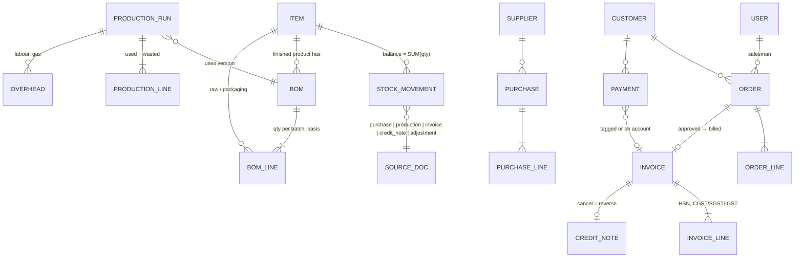

# Design note

## 1. Data model



Three conventions keep the numbers exact:

| What | Stored as | Example |
| --- | --- | --- |
| Quantity | integer **base unit** per item: g, ml or pcs | 10.5 L oil → `10500` |
| Money | integer **paise** | ₹187.50 → `18750` |
| Rates | integer **basis points** | 5% GST → `500`, 3% tolerance → `300` |

No floats touch money or stock. `Decimal` is used only mid-calculation, and results are rounded half-up to a whole paisa or base unit.

**Units.** Every item has one base unit and one display unit. `units.to_base(item, qty, unit)` converts kg↔g, l↔ml, and pcs/packet/carton (`carton` = the product's `pack_per_carton`, 20 for Murukku). It refuses wrong dimensions (litres of flour) and anything finer than one base unit.

## 2. How stock is computed

There is **no stock column**. `stock_movements` is an append-only ledger, and every row carries:
`item, signed qty, signed value_paise, kind, source_type + source_id + source_ref, batch_no, expiry, user, date`.

```
balance(item, upto)  = SUM(qty)          WHERE item AND date <= upto
value(item, upto)    = SUM(value_paise)  WHERE item AND date <= upto
opening + receipts − issues − sales ± adjustments = closing      (re-checked per item in the Stock summary report)
```

| Event | Movements written |
| --- | --- |
| Purchase | `+qty` at purchase taxable value |
| Run start | `−qty` per ingredient (used + wasted) at average cost |
| Run complete | `−qty` per packaging item; `+good packets` of FG at the run's total material cost, with a new batch number and expiry |
| Dispatch | `−qty` FG, split across batches, earliest expiry first |
| Credit note | `+qty` back into the *same* batches at the value they left with |
| Adjustment | `±qty` with a mandatory reason |

Nothing is ever edited or deleted. Wrong entries are reversed by new movements (credit note, run reversal, adjustment), so the ledger is also the audit trail. `post()` refuses to take any item below zero and locks the item row (`SELECT … FOR UPDATE` on Postgres), so two desks cannot oversell.

**Reservation.** An invoice that is posted but not yet dispatched reserves its quantity. *Available* = on hand − reserved, and that is what the order screen checks before invoicing.

## 3. BOM consumption and variance

A BOM is versioned. Saving it creates version n+1, and every run keeps a pointer to the version it used. Each line has a **basis**:

| Basis | Planned quantity | Used for |
| --- | --- | --- |
| `batch` | qty_per_batch × batches | flour, oil, spice |
| `output` | qty_per_batch × good packets ÷ yield (whole pieces for count items) | pouches, cartons |

`actual = used + wasted` from the run lines. `variance % = (actual − planned) ÷ planned`, flagged when |variance| > the tolerance setting (3%).
Yield variance = (good − expected) ÷ expected. Benchmark: oil 10.5 vs 10 = **+5%**, yield 188 vs 200 = **−6%**, and pouches 194 vs 188 = **+3.19%** (the 6 damaged), all flagged. Flour, spice and cartons (9 vs 9) are at 0%.

A run is two steps because that is how the floor works: ingredients are issued at the start, and packaging and output are counted at the end.

## 4. Costing and valuation

**Valuation method: moving weighted average.** Each receipt adds its quantity and value to the item's pool. Each issue leaves at pool value ÷ pool quantity, and the last unit out takes the exact remaining paise, so no rounding residue is left.
*Why:* flour bought at different prices is mixed in one bin, so weighted average describes the physical reality. It is also simpler to explain than FIFO, and it smooths price swings in cost per packet. FIFO would give ₹30.90 on the benchmark against ₹31.14 here.

**Overheads.**
1. An overhead entered **on a run** goes 100% to that run (the benchmark's ₹1,200 labour + ₹600 gas/power).
2. An overhead entered **for the month** (rent, the electricity bill) is shared across that month's completed runs **in proportion to good packets**. Each packet of the same product uses roughly the same fryer time and labour, so output is a fair and easily audited driver.

```
cost per packet = (raw material + packaging + overheads) ÷ good packets
                = (3,435 + 620 + 1,800) ÷ 188 = ₹31.14     margin vs ₹50 = ₹18.86 (37.7%)
```
Wastage is included in material cost, so poor yield shows up directly as a higher cost per packet.

## 5. GST

- Place of supply = the customer's state code. If it equals the factory's (33, Tamil Nadu), the invoice is intra-state with CGST + SGST at half the rate each; otherwise it is IGST at the full rate.
- Tax is computed per line, rounded half-up to the paisa. Invoice totals are the sum of the lines.
- Numbering is gapless per financial year (`INV/2026-27/0001`), using a locked sequence row. Credit notes (`CN/…`), receipts, orders, runs and purchases follow the same pattern.
- The GST summary groups outward supplies the way they are filed: GSTR-1 4A (B2B), 7 (B2C), 9B (credit notes), 12 (HSN), plus the GSTR-3B 3.1(a) totals net of credit notes.

## 6. Roles and audit

Every route declares the area it belongs to and whether it writes. `web/deps.py` holds one table of role → allowed areas, so permissions can be reviewed in one place. Every business action writes an `audit_log` row (user, time, document number, JSON before/after for edits). Order edits record the old and new quantity and price. Posted invoices can only be cancelled with a credit note.
